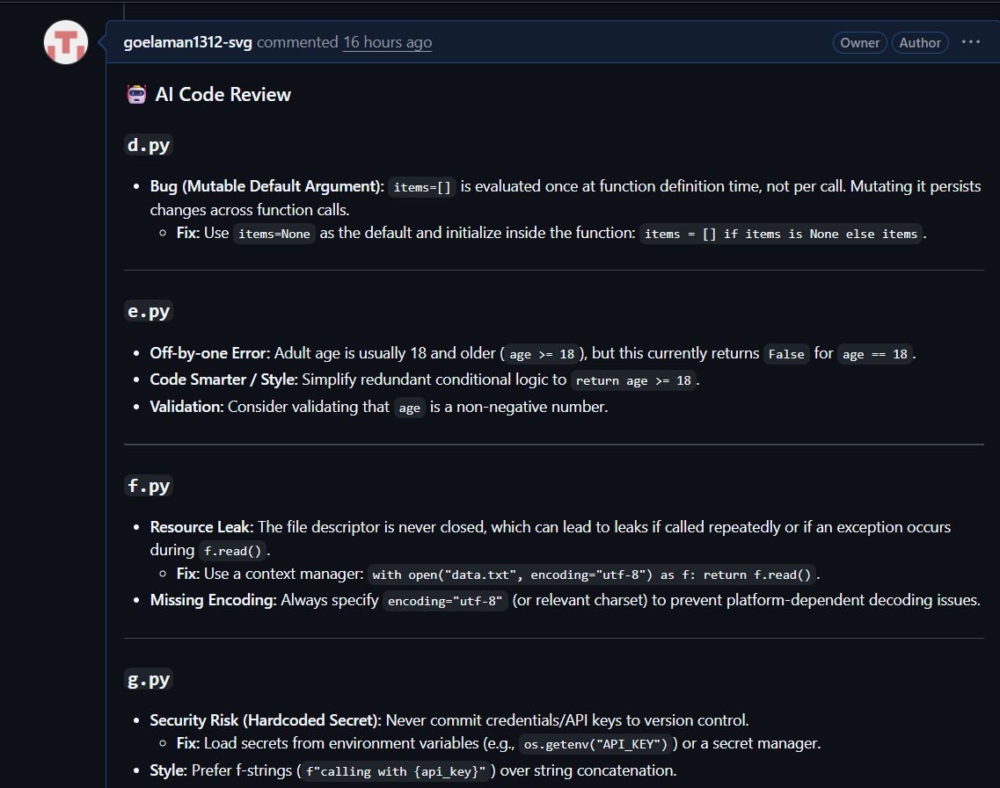

# AI Code Reviewer

A GitHub App that automatically reviews pull requests using Gemini. When a PR is opened, it fetches the diff, generates a review, and posts it as a comment.



## How it works

1. A developer opens a pull request
2. GitHub sends a webhook to the FastAPI server
3. The server verifies the request signature (HMAC-SHA256)
4. It responds immediately and processes the review in a background task
5. The diff is sent to Gemini and the review is posted back on the PR

## Tech stack

FastAPI, PyGithub, Google Gemini API, GitHub Apps and Webhooks, Render

## Features

- Webhook signature verification so only real GitHub requests are accepted
- Background processing so GitHub never times out on large PRs
- Secrets stored in environment variables, never in code
- Multi-file diff review

## Run locally

```
pip install -r requirements.txt
uvicorn app:app --reload --port 8000
```

Create a `.env` file with `GITHUB_TOKEN`, `GEMINI_API_KEY` and `WEBHOOK_SECRET`.

## Roadmap

- Per-file review with LangGraph for large PRs
- Store review history in PostgreSQL
- Evaluation on a labeled set of buggy and clean code